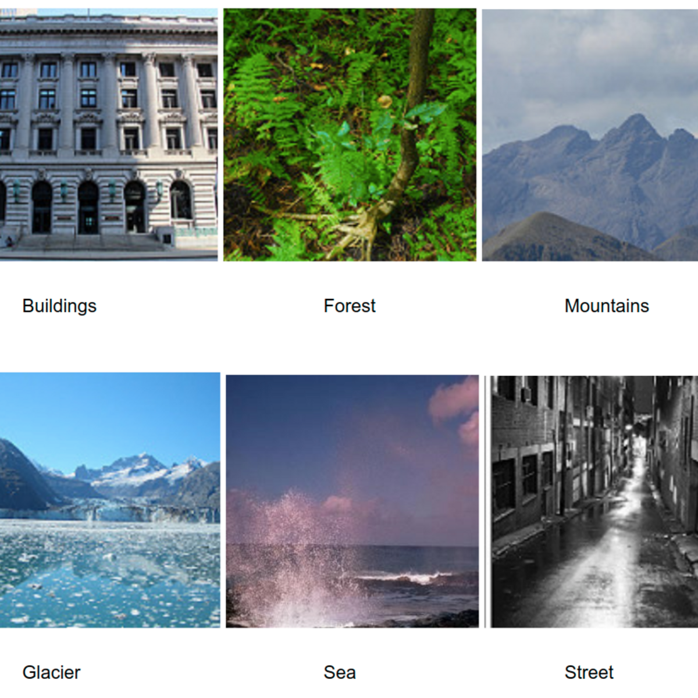

# :dog: HW#7 Intel Image Classification

## :dog: Note

Assignment page: https://condor.depaul.edu/ntomuro/courses/483/2026fall/assign/HW7/hw7-2026.html

### :robot: Repository of the files related to the assignment.
<ul>
  <li>"483-hw7-kaggle-init.ipynb" -- Start-up Notebook file for the <b>Kaggle development platform</b></li>
  <li>"KaggleCode-fall2026.pdf" -- how to get started with the Kaggle development platform</li>
  <li>"Colab_with_Kaggle.pdf" -- how to develop code on Colab for Kaggle</li>
</ul>

## Kaggle Competition

Competition site: https://www.kaggle.com/t/2c14601cbaeb4171a9e303beba5459a7

Submissions (on Kaggle) are accepted until <b>November 8 (Sun) 6:59 pm</b> (CDT).  Note the homework submissions (on D2L) are due the same day, <b>11:59 pm</b> (CDT).

## Acknowledgments

Maintained by Noriko Tomuro
